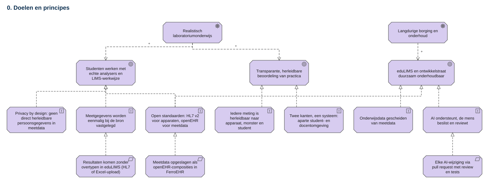
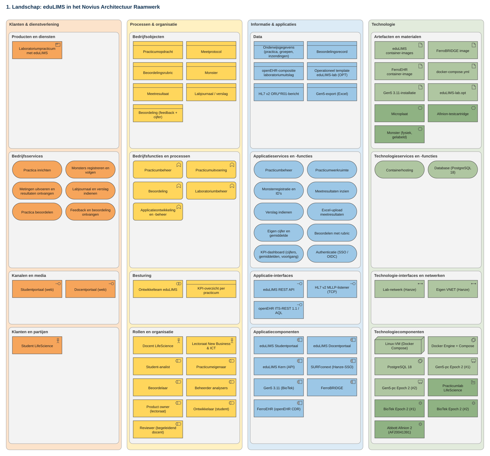
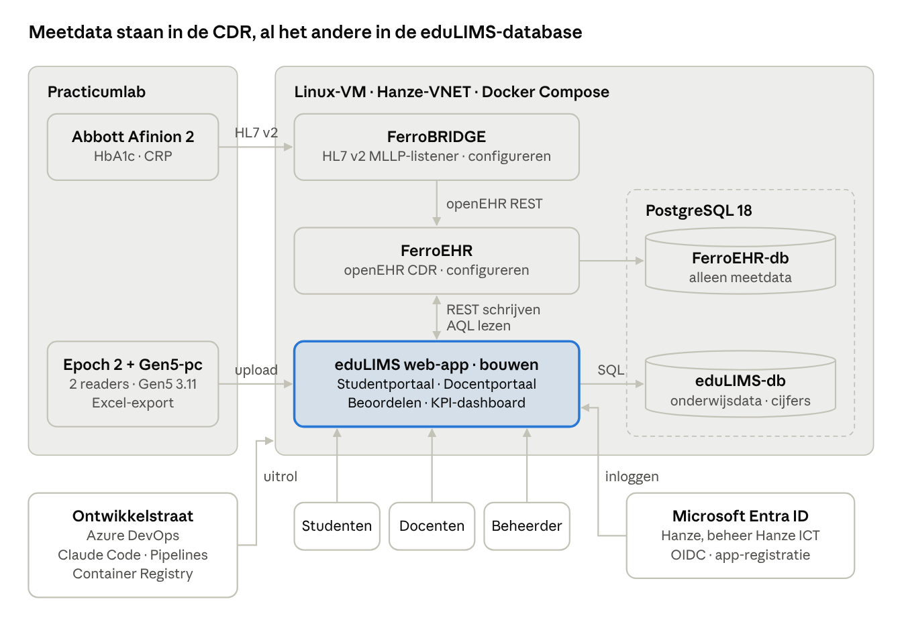
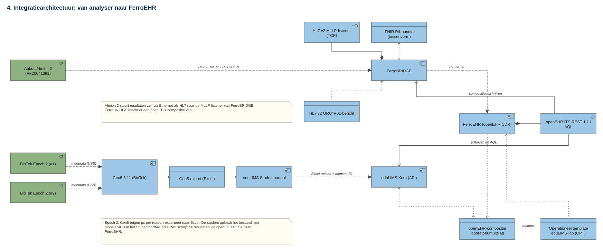
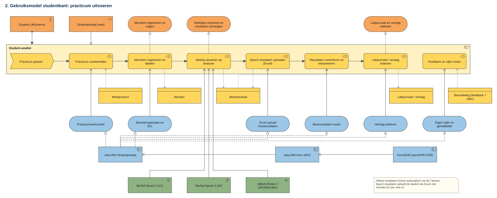
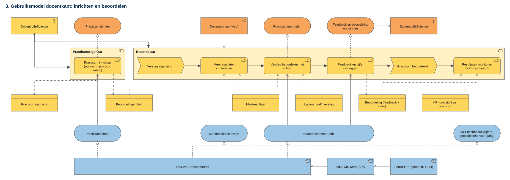
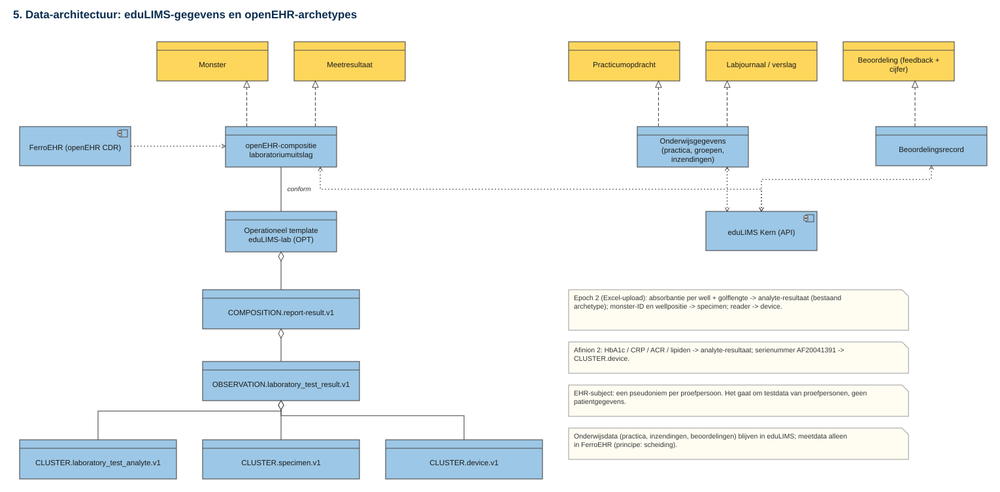
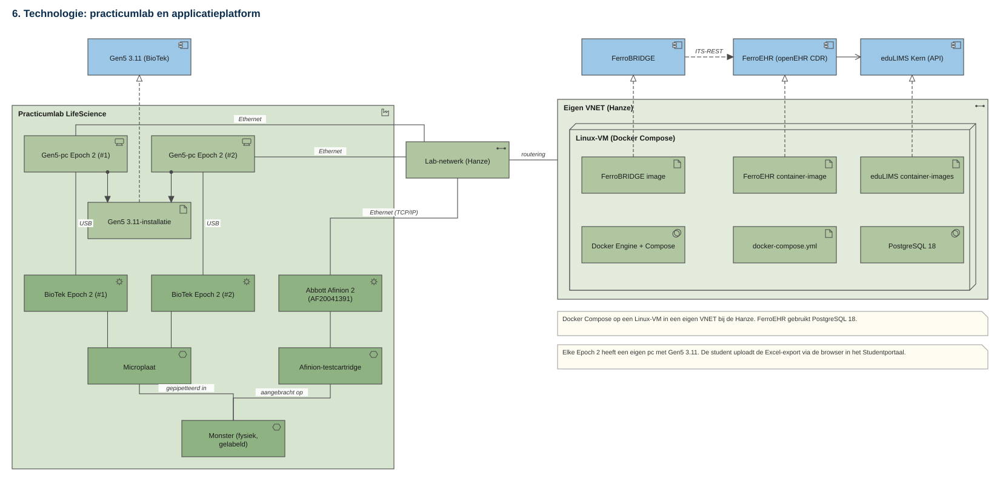
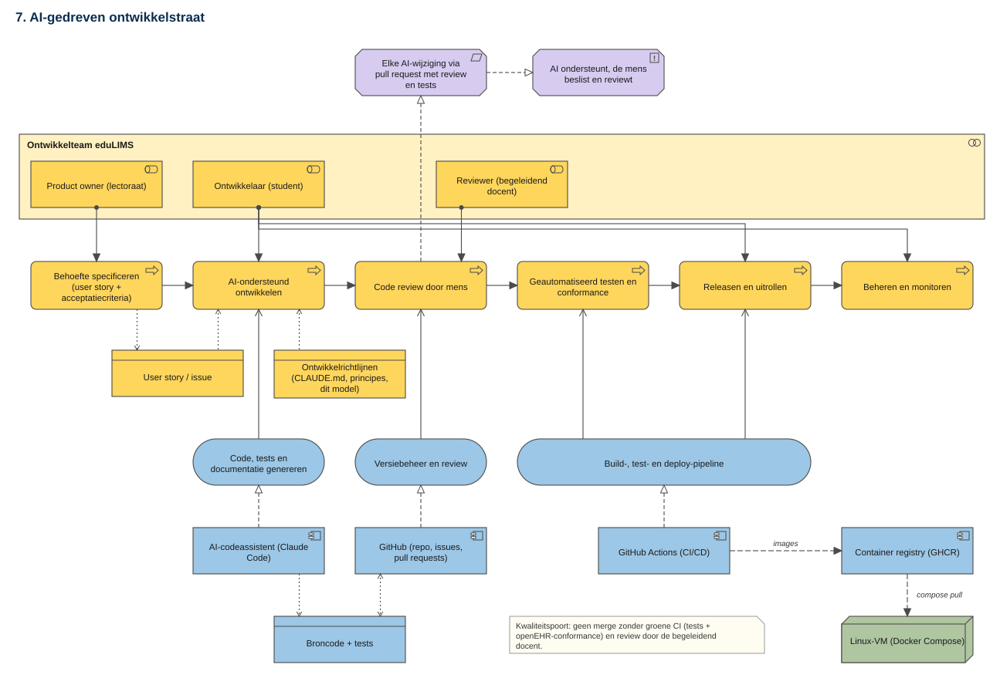
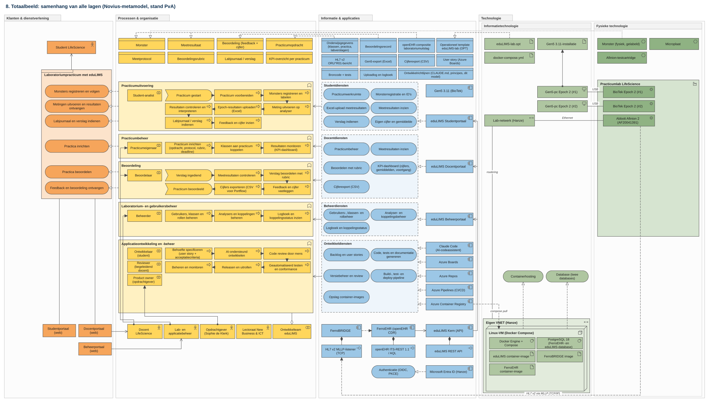

<!-- SPDX-FileCopyrightText: Ruben Talstra -->
<!-- SPDX-License-Identifier: Apache-2.0 -->

# Architecture

eduLIMS is a Laboratory Information Management System for the LifeScience
practical courses at Hanze. It is one web application with three portals
(student, teacher, administrator) on a shared core. The core keeps teaching
data in its own PostgreSQL database and reads and writes measurement data as
openEHR compositions in FerroEHR.

This document is the design authority. It distils the ArchiMate model
(Novius architecture framework, model of 2026-09-29) and the Plan van Aanpak
(PvA). Where the two disagree, the PvA and the later
[decision records](adr/README.md) win; the differences are listed under
[Model status](#model-status). Requirement IDs refer to
[requirements.md](requirements.md).

## Drivers

Two drivers shape the design:

- **Realistic laboratory education.** Students work as in a real lab, where a
  measurement lands in a LIMS without retyping.
- **Long-term continuity.** eduLIMS and its development lane stay
  maintainable inside the research group's CollabSpace after the student
  project ends.

## Principles

From view 0 of the model. Every design decision can be checked against them.

| Principle | Consequence for the design |
|---|---|
| Privacy by design | Measurements come from volunteer subjects: test data, no patient data. Subjects get a pseudonym as EHR subject in FerroEHR. |
| Record once, at the source (eenmalig vastleggen bij de bron) | Afinion results arrive through HL7; Epoch results through an Excel upload. Nobody retypes a measured value. |
| Open standards | HL7 v2 for the Afinion 2; openEHR archetypes and templates for measurement data. |
| Traceability (herleidbaarheid) | Every measurement links through its sample ID to device, sample and student (Q-TRACE-1). |
| Two sides, one system | Separate student and teacher portals on one eduLIMS core. |
| Separate teaching and measurement data | Practicals and assessments in eduLIMS; measurement results in FerroEHR. |
| AI assists, a person decides (AI ondersteunt, mens beslist) | No AI-written change without a pull request, review by the supervising teacher and green tests ([ADR 0009](adr/0009-no-ai-attribution-human-review.md)). |

The landscape view classifies every element in the four columns and four
layers of the Novius framework. It is a checklist without relations.

## Context and integrations

eduLIMS integrates with five systems. Brightspace and Portflow are not
integrated on purpose: grading stays in eduLIMS, and teachers copy grades to
Portflow by hand with help of the CSV export (D6).

| Interface | From → to | Protocol | What is built | Priority |
|---|---|---|---|---|
| Afinion 2 → FerroBRIDGE | analyser → integration layer | HL7 v2 over MLLP (TCP/IP, Ethernet) | configuration only: FerroBRIDGE's IP address and port on the device; HL7 to openEHR mapping | Must |
| FerroBRIDGE → FerroEHR | integration layer → CDR | openEHR REST (ITS-REST 1.1.0) | mapping to the template `eduLIMS-lab` | Must |
| Epoch 2 / Gen5 → eduLIMS | Gen5 PC → web app | Excel file (fixed export template, sample ID per well) | upload, parser and validation in the student portal (S4) | Must |
| eduLIMS → FerroEHR (write) | web app → CDR | openEHR REST, compositions | convert Epoch results to compositions | Must |
| eduLIMS → FerroEHR (read) | web app → CDR | AQL 1.1 | queries per sample, student and practical | Must |
| eduLIMS ↔ Microsoft Entra ID | web app → Hanze SSO | OpenID Connect, authorization code flow with PKCE | app registration by Hanze ICT; roles through app roles or groups ([ADR 0005](adr/0005-better-auth-entra-id.md)) | Must |
| GitHub → VM | development lane → platform | GitHub Actions, GHCR, Docker Compose | CI/CD with tests and openEHR conformance ([ADR 0002](adr/0002-github-instead-of-azure-devops.md)) | Must |
| eduLIMS → CSV export | web app → teacher | CSV | export of grades (D6) | Should |
| eduLIMS ↔ Brightspace, Portflow | | | not built (decision 2026-09-29) | Won't |

### Two routes from analyser to FerroEHR

| Device | Route | What is built |
|---|---|---|
| Abbott Afinion 2 (serial AF20041391), HbA1c and CRP | sends HL7 v2 itself over Ethernet to the MLLP listener of FerroBRIDGE | configuration only |
| BioTek Epoch 2 (#1 and #2) | Gen5 3.11 on its own PC exports to Excel; the student uploads the file in the student portal | an upload in eduLIMS that parses the file and writes the results through openEHR REST to FerroEHR |

The Epoch 2 has no direct link and Gen5 does not speak HL7, so the upload is
the simplest route. eduLIMS writes directly to FerroEHR; FerroBRIDGE is only
needed for the Afinion's HL7 messages.

The Gen5 export template must be fixed, preferably as a table with the sample
ID per well (positions A1 to H12). Then eduLIMS can link every measurement to
a student. The parser validates strictly and rejects a file with an unknown
sample ID or an invalid well position (S4, R-06).

### The sample ID

The sample ID (monster-ID) is the key that connects every interface. eduLIMS
creates it (S3); the student enters it on the Afinion 2 and puts it in the
Gen5 export; FerroEHR stores it in `CLUSTER.specimen.v1`; the eduLIMS database
links it to the student and the practical.

## Portals and roles

eduLIMS has three roles. A user's role comes from Entra ID (app roles or
groups) and is enforced on the server for every request (Q-SEC-1, Q-SEC-2).

| Role | Portal | May | Sees |
|---|---|---|---|
| Student | Studentportaal | register samples, upload Excel, submit the lab report | own practicals, own measurements, own grade next to the class and practical average |
| Teacher (docent) | Docentportaal | set up practical, protocol and rubric; link classes; check results; grade; record feedback and grade | all students, submissions and measurements of their own practicals; KPI dashboard of their own classes |
| Administrator (beheerder) | Beheerportaal | manage users, classes and roles; manage analysers and the FerroEHR and FerroBRIDGE integrations | logs, integration status, analyser usage |

"View measurement results" is the same application service for student and
teacher with a different scope: the teacher sees all students of their
practical, the student only their own work.

### Core process

1. The teacher sets up a practical (assignment, protocol, rubric, deadline).
2. The student registers samples and receives sample IDs.
3. The student measures on the Afinion 2 (the result goes to FerroEHR on its
   own) or on the Epoch 2 and uploads the Excel export.
4. The student checks the results and submits the lab report. The submission
   is then locked (S6).
5. The teacher grades with the rubric and records feedback and grade.
6. The student sees feedback and grade; the KPI dashboard updates.

## Data

eduLIMS uses two databases on one PostgreSQL 18 server. Grades stay out of the
CDR on purpose: they belong to real students, while the CDR only holds
pseudonyms of volunteer subjects, and this way no custom archetypes are
needed.

| Database | Holds | Read with |
|---|---|---|
| FerroEHR (openEHR CDR) | sample and measurement result as an openEHR composition (template `eduLIMS-lab`, existing CKM archetypes); a pseudonym as EHR subject | openEHR REST, AQL |
| eduLIMS database | users, roles and classes; practicals (assignment, protocol, rubric, deadline); sample IDs linked to student and practical; lab reports; assessments, grades and feedback; upload log and audit log; better-auth's sessions and accounts | SQL through Kysely ([ADR 0006](adr/0006-kysely-for-app-data.md)) |

Each database has its own database user. One server keeps monitoring and
backup simple: one backup routine covers both.

### Template `eduLIMS-lab`

The operational template `eduLIMS-lab` is built only from existing archetypes
from the openEHR Clinical Knowledge Manager (CKM). eduLIMS adds no archetype of
its own.

| Archetype | What it records |
|---|---|
| `openEHR-EHR-COMPOSITION.report-result.v1` | the result as a whole: who, when, which practical |
| `openEHR-EHR-OBSERVATION.laboratory_test_result.v1` | the test and the status of the result |
| `openEHR-EHR-CLUSTER.laboratory_test_analyte.v1` | per analyte the value with unit: HbA1c or CRP (Afinion), absorbance per well and wavelength (Epoch) |
| `openEHR-EHR-CLUSTER.specimen.v1` | the sample: sample ID from eduLIMS, type and well position |
| `openEHR-EHR-CLUSTER.device.v1` | the device, for example the Afinion 2 with serial number AF20041391 |

Every composition eduLIMS writes passes openEHR validation against this
template (Q-COMP-1).

### Reporting

The KPI dashboard is built inside eduLIMS, not in Power BI: Power BI cannot
reach a local PostgreSQL directly, and nested openEHR compositions are hard to
report on there. Grade KPIs use SQL on the assessment records; measurement
quality and analyser usage use AQL on FerroEHR. The analytical model is a star
schema with three fact tables (submission, assessment, measurement) and
dimensions for student, class, practical, rubric criterion and date. Details
are in [kpi-dashboard.md](kpi-dashboard.md).

## Application structure

| Concern | Choice | Record |
|---|---|---|
| Web framework | TanStack Start with full server-side rendering on Vite, served by a Nitro Node server | [ADR 0003](adr/0003-tanstack-start-full-ssr-on-vite.md) |
| Language | TypeScript 7 native compiler; Biome for lint and format | [ADR 0004](adr/0004-typescript-7-native-compiler.md) |
| Sign-in and sessions | better-auth with Microsoft Entra ID, PostgreSQL adapter through Kysely | [ADR 0005](adr/0005-better-auth-entra-id.md) |
| Application data access | Kysely with `pg` | [ADR 0006](adr/0006-kysely-for-app-data.md) |
| Runtime and package manager | Node.js 26 LTS, pnpm 12 | [ADR 0007](adr/0007-node-26-lts-and-pnpm-12.md) |

Server functions in TanStack Start hold the business rules and the access
checks; route loaders call them. FerroEHR is called only from the server, so
the browser never talks to the CDR.

## Deployment

Two places carry the system:

- **The practical lab.** Each Epoch 2 has its own PC with Gen5 3.11, connected
  over USB. The Afinion 2 is on the lab network over Ethernet, and the lab
  network routes to the VNET. The sample ID is on the physical sample, which
  closes the traceability chain.
- **A Linux VM in its own Hanze VNET.** All parts run as containers through
  Docker Compose ([ADR 0008](adr/0008-docker-compose-ghcr-slsa.md)).

| Container | Role in this project |
|---|---|
| eduLIMS (web app and backend) | built here |
| FerroEHR | configured: upload the template `eduLIMS-lab`; not developed here |
| FerroBRIDGE | configured: MLLP listener and HL7 to template mapping; not developed here |
| PostgreSQL 18 | one server, two databases: FerroEHR's and eduLIMS's |

Images are built in GitHub Actions, pushed to GHCR with SLSA Build Level 3
provenance, and pulled onto the VM with `docker compose pull`. The client has
not yet fixed whether hosting stays on a Hanze VM or moves to Azure; Docker
Compose keeps both open, and the advice is to start local. If hosting moves to
Azure, a managed PostgreSQL in an EU region replaces the database container
and the FerroEHR plus eduLIMS database split stays the same.

[ci-cd.md](ci-cd.md), [release.md](release.md) and
[deployment.md](deployment.md) describe the lane.

### Development lane

| Step | Who | Supported by |
|---|---|---|
| Specify the need | product owner | user story or issue in GitHub |
| AI-assisted development | developer (student) | Claude Code, with `CLAUDE.md` and the rules as context |
| Code review by a person | reviewer (supervising teacher) | GitHub pull requests |
| Automated tests and conformance | pipeline | GitHub Actions: tests plus openEHR conformance |
| Release and roll out | developer | GHCR and `docker compose pull` on the VM |
| Operate and monitor | developer, administrator | the Linux VM (Docker Compose) |

## Quality requirements

The full list with acceptance criteria is in
[requirements.md](requirements.md#quality-requirements). The ones that shape
the architecture:

| ID | Requirement | Where the architecture answers it |
|---|---|---|
| Q-SEC-1, Q-SEC-2 | SSO only; access per role, filtered on own data | Entra ID through better-auth; role and ownership checks in server functions; no client-side access to FerroEHR |
| Q-SEC-3 | HTTPS; measurement data stays in the Hanze VNET | everything on one VM in the VNET; TLS terminated in front of the app ([deployment.md](deployment.md)) |
| Q-PRIV-1, Q-PRIV-2 | pseudonyms only in the CDR; averages from 5 assessments | data split between CDR and eduLIMS database; threshold in the KPI queries |
| Q-TRACE-1 | measurement traceable to device, sample and student | sample ID across all interfaces |
| Q-PERF-1, Q-PERF-2 | pages within 2 s; upload within 10 s | server rendering; parsing and validation on the server, one REST write per composition |
| Q-REL-1 | 99% of practical hours; recovery within one working day | Compose stack restarts; one backup routine for both databases |
| Q-ACC-1 | WCAG 2.1 AA | shadcn/ui on Radix primitives; axe in Playwright tests |
| Q-MAINT-1 | core coverage at least 70%; docs and model current | Vitest coverage gate; this document and the model in the Definition of Done |
| Q-SUST-1 | one environment, no idle services | one VM, one Compose file |
| Q-COMP-1 | HL7 v2, openEHR REST and AQL | FerroBRIDGE for HL7; template validation in FerroEHR |

## Model status

The model files are in [`docs/architecture/`](architecture/):
`eduLIMS_novius.xml` (ArchiMate 3.1 Open Exchange format, 133 elements, 227
relations, views 0 to 7) and one SVG per view. View 8 exists only as
`view8-totaal.svg`. To open the model: Archi, then File, Import, Open Exchange
XML Model.

Views 0 to 7 date from 2026-09-29. View 8 followed the PvA. The current
decisions differ from both on these points:

| Topic | Views 0 to 7 (2026-09-29) | View 8 (PvA) | Current decision |
|---|---|---|---|
| Sign-in | SURFconext (Hanze SSO) | Microsoft Entra ID, OIDC with PKCE | Microsoft Entra ID, OIDC with PKCE |
| Development lane | GitHub, GitHub Actions, GHCR | Azure Boards, Repos, Pipelines, Container Registry | GitHub Issues, Projects, Actions and GHCR ([ADR 0002](adr/0002-github-instead-of-azure-devops.md)) |
| Product owner | the research group | client Sophie de Klerk; the research group oversees | as in the PvA |
| Analyser management | teacher | separate administrator role with an administration portal | as in the PvA |
| Teaching data | eduLIMS's own database | separate eduLIMS database on the same PostgreSQL 18 server as FerroEHR | as in the PvA |
| Teacher side | set up and grade | also link classes and export grades as CSV | as in the PvA |
| Hosting | Linux VM in a Hanze VNET | not yet fixed: Hanze VM or Azure | Hanze VM first; Compose keeps Azure open |

Updating views 0 to 8 to the current decisions is tracked in the backlog
(`task-archimate-update`).
