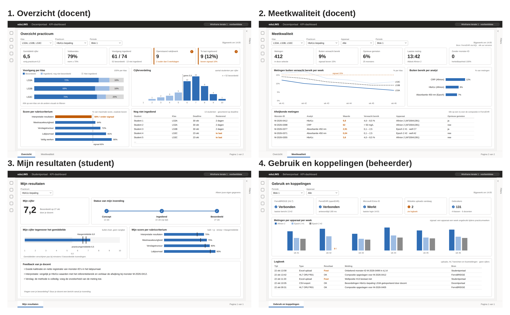
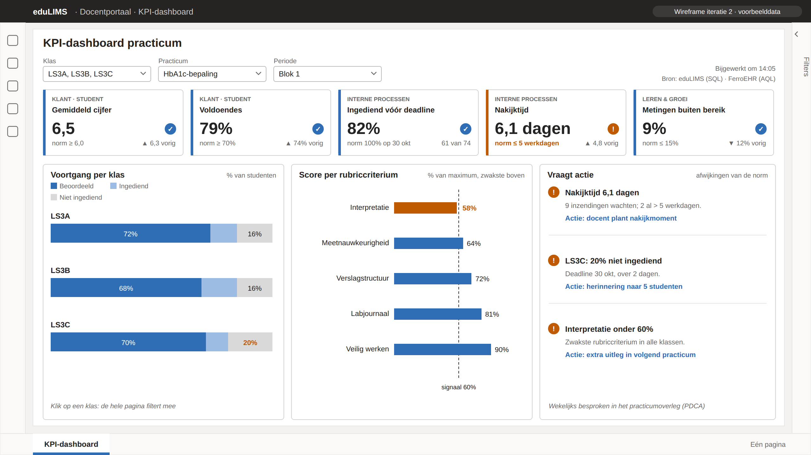

<!-- SPDX-FileCopyrightText: Ruben Talstra -->
<!-- SPDX-License-Identifier: Apache-2.0 -->

# KPI dashboard

This document describes the design of the KPI dashboard (requirement D5). It
is a translation of the owner's *KPI-dashboard eduLIMS: wireframe en
bedrijfsinformatie*, with the visualisation advice from the *Adviesrapport*.
KPI IDs refer to [requirements.md](requirements.md#kpis).

The dashboard lives in the teacher portal of eduLIMS, not in Power BI. All
data is in PostgreSQL, which runs locally, and Power BI cannot reach it
directly. The measurement data is in openEHR, which is hard to report on in
Power BI. The wireframes are drawn in Power BI style because the course uses
Power BI.

## Mission and vision

**Mission.** LifeScience teachers see at a glance how their classes are doing.
Today they open every Excel file and photo on its own, and that takes a lot of
time.

**Vision.** The practical works more like a real laboratory. Measurements come
in on their own, and teachers steer on figures instead of on feeling. The
dashboard only gives signals; the teacher decides what to do with them.

## KSFs, KPIs and norms

The KPIs are derived with the Balanced Scorecard. Per perspective the design
first sets what eduLIMS must be good at (the key success factor, KSF) and then
how to measure it. Every KPI has a norm. The norms are a proposal, to be set
with the teachers using the baseline from the quantitative analysis.

| BSC perspective | KSF | KPI | ID | Norm |
|---|---|---|---|---|
| Customer (student) | Students pass the practical | Average grade | K-01 | ≥ 6.0 |
| Customer (student) | Students pass the practical | Pass rate (voldoendes) | K-04 | ≥ 70% |
| Internal processes | Submissions arrive on time | Submitted before deadline | K-05 | 100% at the deadline |
| Internal processes | Fast feedback for students | Grading time (submitting to grading) | K-06 | ≤ 5 working days |
| Learning and growth | Working as in a real lab | Measurements outside the expected range | K-08 | ≤ 15% |

The financial perspective is left out: eduLIMS has no revenue or cost to
steer on.

## Data

The dashboard reads from the two databases eduLIMS already uses. No extra
source or copy is needed.

| Source | What it provides | For KPI |
|---|---|---|
| eduLIMS database (SQL) | submissions (submitted at, deadline, status), assessments (grade, score per rubric criterion, graded at), classes | K-01, K-04, K-05, K-06 |
| FerroEHR (AQL) | measurements per sample ID: analyte, value, device | K-08 |

The sample ID connects the two sources, so every measurement is known to
belong to a student and a class. The analytical model is a star schema with
three fact tables (submission, assessment, measurement) and dimensions for
student, class, practical, rubric criterion and date.

## Security

The course taught how to secure a dashboard in the Power BI service. Because
this dashboard is inside eduLIMS, eduLIMS does the same things itself:

- Access goes through Entra ID groups, not per person. Only the teacher group
  opens the dashboard.
- A teacher sees only their own classes and practicals (row-level security in
  Power BI terms; Q-SEC-2).
- Names and data of volunteer subjects from FerroEHR never reach the
  dashboard, only sample IDs (similar to object-level security).
- An average appears only from five assessments on; with fewer, someone's
  grade can be worked out (Q-PRIV-2).
- Opening the dashboard and every export are logged. All traffic uses HTTPS.

## Design

### Iteration 1: four pages

The first version had four pages: two for the teacher, one for the student,
one for the administrator. Held against the BI theory, it had problems:

- A KPI dashboard is one page. Four pages make a report.
- It had sixteen cards, many without a norm. The theory keeps to about five
  KPIs, each with a norm.
- The student and administrator pages are not steering information. They
  belong in the student portal and the administration portal.
- It showed what deviated, but not what the teacher should do about it.

### Iteration 2: one page

The second version is one page for the teacher:

- Five KPI cards. Each card shows its BSC perspective, its norm, and whether
  the KPI meets the norm, with an icon and text as well as colour (Q-ACC-2).
- Two charts that explain why a KPI deviates: progress per class (K-02) and
  score per rubric criterion (K-07).
- A block "Needs action" (Vraagt actie) that names an action per deviation.
  This follows the PDCA cycle, where deviations are discussed weekly and
  actions are recorded.
- Filters on class, practical and period, plus a filter on cohort, which a
  teacher asked for in the interview.

Iteration 2 is not yet tested with teachers. The next step is a think-aloud
test with three to five LifeScience teachers, setting the norms with them
([test-strategy.md](test-strategy.md)).

### Charts

Every chart answers the teacher's question as fast as possible.

| The teacher wants to know | Chart | Why |
|---|---|---|
| How are we doing? | KPI card with norm and status | one number with a norm reads at a glance |
| Which class is behind? | stacked bar per class | shows the part graded, submitted and not submitted |
| Where do students score weakly? | sorted bar per rubric criterion | the weakest criterion is on top |
| What should I do? | list "Needs action" | links each deviation to an action (PDCA) |

No pie charts or gauges: they take a lot of space and are hard to compare.

### Ethical limits

- **No ranking.** The dashboard compares classes, not students. A student
  sees only their own grade next to the average, in the student portal (K-03).
- **No average for small groups.** An average appears from five assessments
  on.
- **Signals, not decisions.** The dashboard shows what deviates; the teacher
  decides what to do.
- **Accessible.** A deviation gets an icon and text next to its colour
  (WCAG 2.1 AA).

## Design cycle

| Step | What was done |
|---|---|
| Problem diagnosis | Teachers open every file on its own and miss an overview per class (PvA, teacher interview). |
| Design plan | Mission, vision and KPIs derived with the Balanced Scorecard, each with a norm. |
| Make the design | Iteration 1 with four pages, iteration 2 with one page. |
| Test the design | Iteration 1 checked against BI theory; iteration 2 extended with the interview. The test with teachers follows. |
| Look back | What was wrong in iteration 1 and what changed in iteration 2 (above). |

## Sources

- De Jager, E. and Van Slooten, J. *Navigeren met KPI-dashboards*. Noordhoff.
- Hanze, Business Intelligence knowledge sessions weeks 3 and 5 (2026).
- Microsoft Learn: Tips for designing a great Power BI dashboard.
- W3C (2018). Web Content Accessibility Guidelines (WCAG) 2.1.
