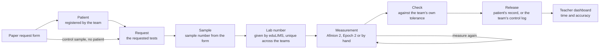
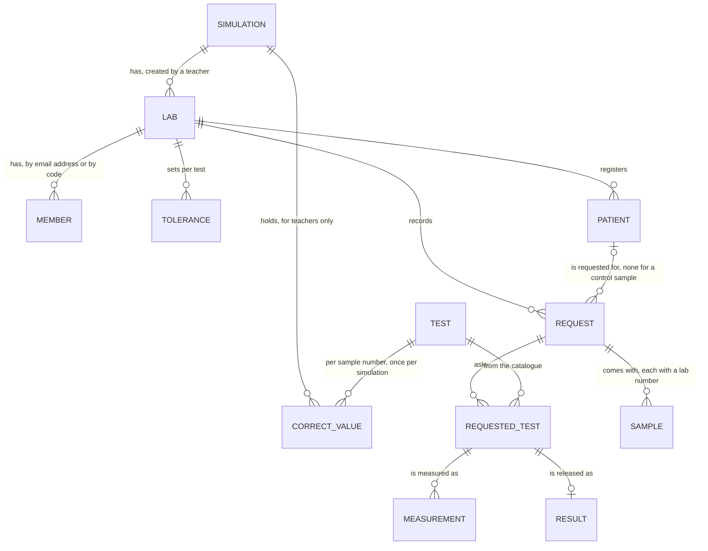
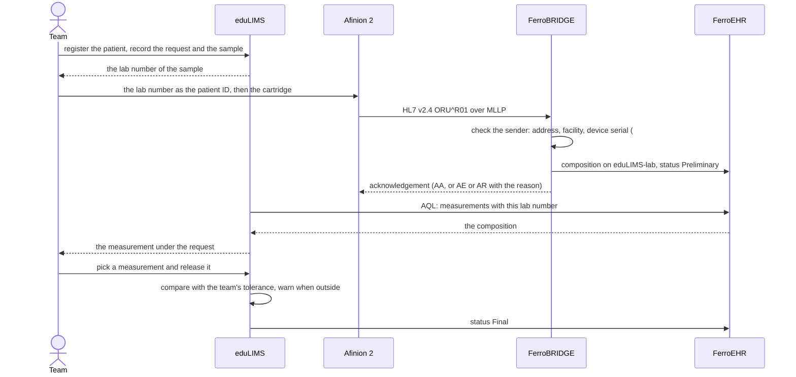
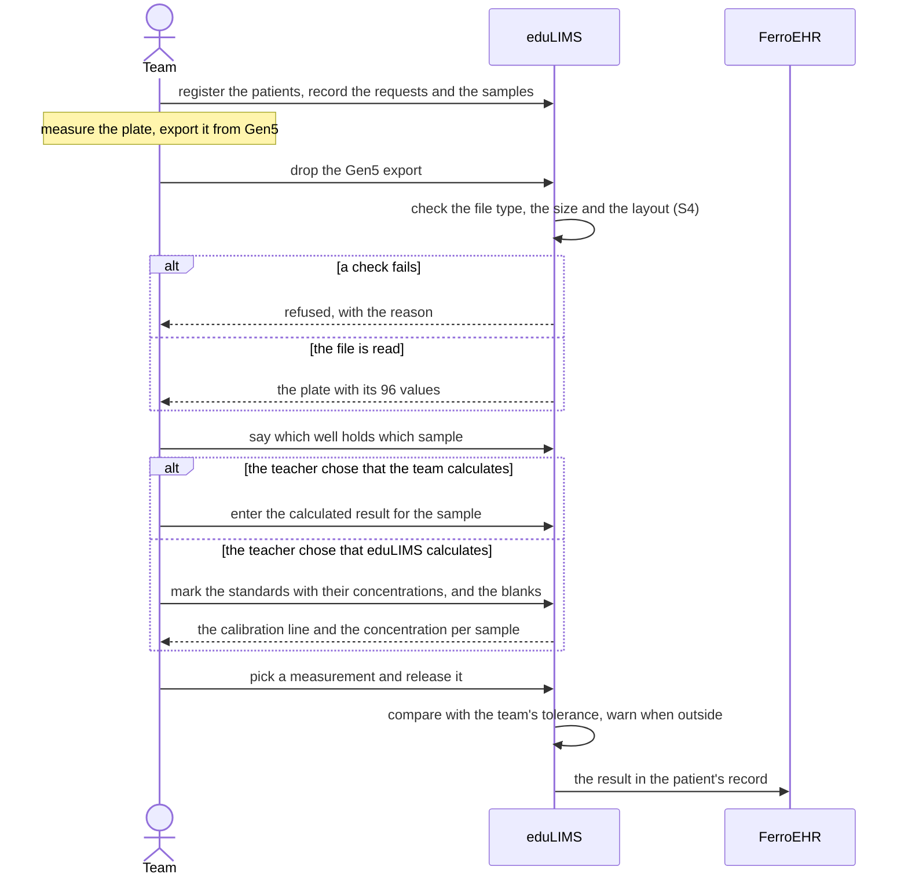
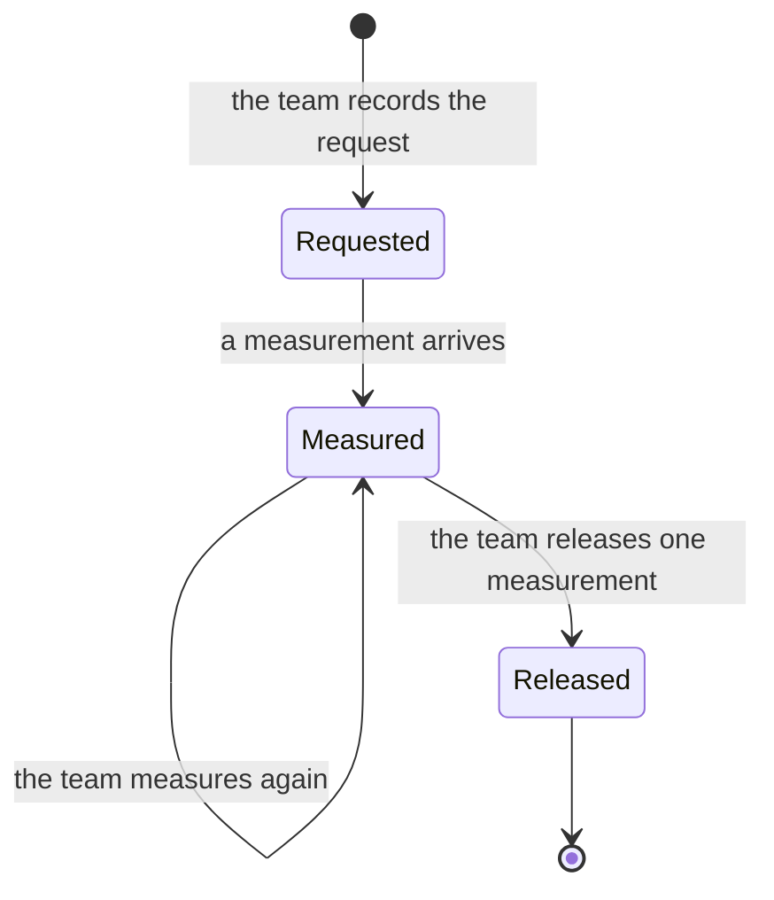

<!-- SPDX-FileCopyrightText: Ruben Talstra -->
<!-- SPDX-License-Identifier: Apache-2.0 -->

# The LIMS workflow

This page shows how the work of a lab travels through eduLIMS during a
simulation, from the paper request form to the result in the patient's record and
on the teacher's dashboard. Teams practise the workflow of a real clinical
laboratory, so eduLIMS follows the chain a real LIMS follows
([ADR 0020](adr/0020-workplace-simulation.md)).

Status: the chain follows the owner's input and the decisions of
2026-11-19 in [requirements.md](requirements.md). The owner holds two
questions for the next iteration, time targets and urgent requests (O1) and
the ranking (O3), and nothing is built for them. Engineering points that an
issue still settles are marked **Open**; nothing is built on an open point.

## The chain

| Step | What happens | Who | Requirement |
|---|---|---|---|
| Tolerances | Before measuring, the team enters its own lower and upper limit per test. The team can change a tolerance during the simulation; every change is logged, and the teacher sees the tolerances and their changes. | team | S13 |
| Patient | The team registers the patient from the form. eduLIMS fills in nothing. The team can correct the details until the first result for that patient is released; every correction is logged for the teacher. | team | S11 |
| Request | The team records the request as it stands on the form: the requester, the requested tests, whether the result must be phoned through, and the remarks. eduLIMS records the time of entry on the server. The team can correct the request until its first result is released; every correction is logged for the teacher, and the time of entry never changes. An urgent request is not built in this iteration (D12). | team, eduLIMS | S12, Q-SIM-2 |
| Control request | A control sample is a quality-control sample with no patient, and it is its own kind of request. The team records it without a patient, then measures and releases it like any other. | team, eduLIMS | S16 |
| Sample | The team links each sample by the sample number and the material on the form. A lab may record the same sample number twice (a second tube); the lab numbers tell the tubes apart. | team | S12 |
| Lab number | eduLIMS gives the sample a lab number and shows it to the team. The sample number on the form is the same in every team; the lab number is unique across the teams of every simulation, so it names one team's sample. | eduLIMS | S12, R-11 |
| Measurement | The team measures. Per test the teacher sets where a measurement comes from: the Afinion 2, the Epoch 2 upload, or entry by hand. A result calculated from other results is a test with entry by hand. A team can measure again; every measurement is kept. | team, analyser | S4, S5, S14, D9 |
| Check | When the team picks a measurement to release, eduLIMS compares it with the team's own tolerance and warns when it is outside. The team decides. A result can be released only for a test that has a tolerance. | eduLIMS, team | S13, S15 |
| Release | The team releases the result to the patient's record. eduLIMS records the time of release on the server and keeps the tolerance that was in force at the release. The result of a control request goes to the control log of the team, never to a patient's record. A released result is final. | team, eduLIMS | S15, S16, Q-SIM-2 |
| Dashboard | The teacher sees the request, its times, every measurement of a requested test with the released one marked and, after the release, the accuracy against the correct value. A control request shows like any other. | teacher | D11, D13, S16 |

eduLIMS never shows a student a correct value, an accuracy status or the
work of another team (Q-SIM-1). The tolerance warning is the one check a
team gets, and it uses only what the team entered itself.

## Who owns what, and where it lives

The work belongs to the lab: the team of students that runs one laboratory
in a simulation. Every patient, request, sample, measurement and result
hangs under the lab within a simulation, and every server function checks
that in its database query (S10). A teacher sees the labs of their own
simulations: the ones they created and the ones another teacher added them
to (D10, [ADR 0021](adr/0021-simulations-and-labs.md)).

| Data | Lives in | Holds no |
|---|---|---|
| Simulations, labs with their names, logos and members, the test catalogue, correct values, tolerances, patients, requests, samples with their lab numbers, the times of entry and release, the upload log and the audit log | the eduLIMS database | |
| Each result of a patient's request as an openEHR composition on the `eduLIMS-lab` template, in the EHR of the patient, with the sample number, the analyte, the value, the device and the time | FerroEHR | correct value, tolerance, accuracy status, or the name, student number or email address of a student or a teacher (Q-PRIV-1) |

- The patient's EHR in FerroEHR carries the fictional details the team
  registered (owner, 2026-11-19). No student or teacher is ever an EHR
  subject.
- A request is for one patient or for a control sample, which has no
  patient (S16). The released result of a control request goes to the
  control log of the team and is in no patient's record. Where a released
  control result is stored, in FerroEHR or in the eduLIMS database, is a
  design decision that is not made yet.
- A correct value is entered once per simulation, keyed by sample number and
  test, and holds for every lab (D10). A lab added later is judged against
  the same values.
- A teacher creates each lab with the name and the logo its team made up,
  and eduLIMS shows the lab under them (D10, S10).
- Every student has their own account. A student who signs in with an email
  address a teacher added to a lab is linked to that lab; eduLIMS sends no
  email. A student who signs in with another address joins with the lab's
  code (S10). There are no roles inside a lab: every member may do
  everything, and eduLIMS records who did what. A student can be in several
  simulations, in one lab of each (S10).
- A result released to the patient's record is final: nobody can change it
  or release another measurement for that requested test (S15; owner,
  2026-11-19, O7). The teacher sees every measurement of a requested test,
  and the released one is marked as the one that counts (D11).
- Where a measurement lives before its release is a design matter for the
  maintainer. The template has a result status (Preliminary, Final), so the
  proposal keeps every measurement in FerroEHR as Preliminary and makes the
  released one Final. The Afinion 2 route already writes to FerroEHR on
  arrival, which fits that design.

## A measurement on the Afinion 2

The Afinion 2 sends each result itself over the lab network as HL7 v2.4 to
FerroBRIDGE, which writes it to FerroEHR. The operator enters a patient ID and an operator ID on the analyser, up to
16 characters each (Afinion 2 User Manual, 1117346 Rev. A, 2023/02, "Patient
ID" and "Operator ID"). The message carries one patient ID, in PID-3 or in
PV1-19 as set on the analyser, the operator ID in OBX-16 and the analyser's
serial number in OBX-18 (Afinion 2 HL7 Connectivity Protocol v4.0, §3.5,
§3.6 and §3.8). Both documents are vendored in `docs/vendor/afinion/`.

A result finds its team through the patient ID the team enters on the
analyser (owner, 2026-11-19, O13). That value is the lab number eduLIMS gave
the sample when the team recorded it (S5, S12).

- Every team works the same sample numbers, so the sample number alone does
  not say whose result arrived (R-11). The lab number does: it is unique
  across the teams of every simulation, and eduLIMS links the result to the one
  sample that carries it. It is ten decimal digits, the last a check digit by the
  Damm algorithm, so a typing mistake on the analyser matches no other sample
  (#268); the patient
  ID field takes up to 16 characters.
- The entered patient ID goes out in PID-3 or in PV1-19: the analyser's
  setting "Patient ID As" chooses between "HIS Patient ID" and "Visit
  Number" (manual, Table 2; protocol §3.5: "configurable, to use PID or
  visitnumber"). Every analyser of an installation is set the same way, and
  the mapping reads that one field (#160).
- A quality control run on the analyser arrives with `Q` in MSH-11 (protocol
  §3.2). What eduLIMS does with it is settled in #160.
- **Open, FerroHEALTH/FerroBRIDGE#1918:** the Afinion 2 has no TLS, and
  FerroBRIDGE 0.0.24 accepts MLLP only over TLS. The route waits on the
  address-bound plain lane for devices.
- **Open:** how eduLIMS learns about a new measurement within the minute of
  S5: FerroEHR's change feed, or a short query interval.
- A result that eduLIMS cannot link to a team's sample is never attached to
  one: it is logged and shown to administrators (#163).

## A measurement on the Epoch 2

The Epoch 2 has no network route here. The team exports the plate from Gen5
and drops the Excel file on the upload area. eduLIMS loads the values and
shows the plate, as a real LIMS does (S4).

The export is one sheet: a header block (software version, date, time,
reader type and serial number, plate type, read type, wavelength,
temperature) and a 96-well grid, rows A to H and columns 1 to 12, of
absorbance values at one wavelength. It holds no sample number, no plate
layout and no concentration. [The Gen5 export contract](gen5-export.md) pins
the layout cell by cell, with the file limits and every reason for a refusal.

- The team links wells to samples, because the export holds no sample
  number (S4; owner, 2026-11-19, O5).
- Per test, the teacher chooses in the test catalogue who calculates the
  concentration (D9; owner, 2026-11-19). When the team calculates, it works
  by its own procedure and enters the result; eduLIMS keeps the wells the
  result came from beside it. When eduLIMS calculates, the team marks the
  standards with their concentrations and the blanks, and eduLIMS shows the
  calibration line it used, so the team can judge it before a release.
  Neither way uses a correct value (Q-SIM-1).
- When eduLIMS calculates, it subtracts the blank and fits a straight line
  through the standards. A sample outside the range of the standards gets no
  number but the message that it is outside the range (S4; owner,
  2026-11-19, O5).

## The states of a requested test

The clock of G-01 runs from Requested to Released: eduLIMS logs the time a
request enters the system and the time its result is released, and no more
in this iteration (O1).

Released is final. Nobody can change a released result or release another
measurement for that requested test (S15). A requested test of a control
request passes through the same states; its released result goes to the
control log of the team (S16).

## The teacher's side

Before a simulation a teacher manages the test catalogue (D9), where the
teacher also chooses per test who calculates the concentration from an
Epoch 2 plate. A test has a name, a unit (none for a dimensionless result
such as a ratio), a material the teacher types, and a source: the Afinion 2
with the analyte name the analyser sends in OBX-3, the Epoch 2 upload with
who calculates, or entry by hand. Every teacher uses and changes the same
catalogue, and each test records who created it. The names of active tests
are unique regardless of case, and so are the analyte names of active
Afinion 2 tests; matching a result to a test compares the exact text the
analyser sends. A test that a simulation uses keeps its unit, its source and
its analyte name and cannot be deleted; while a running simulation uses it,
its material and who calculates are fixed too. A teacher retires a test so
new simulations no longer offer it, and can restore it.
The teacher then prepares the simulation (D10): gives it a
name, creates its labs, each with the name and the logo the team made up,
and adds the members of a lab by pasting their email addresses. The teacher
enters the correct value per test and sample number, and sets the limits for
green, yellow and red (D13). Per test the teacher sets the limit for yellow
and the limit for red, each as a percentage of the correct value or as an
absolute distance; a value exactly on a limit gets the better colour. The
correct values are entered once per simulation and hold for every lab, so
adding or removing a lab is no extra work. A teacher can change a correct
value before, during and after the simulation; the change is logged and the
dashboard follows the current value. A teacher can add other teachers to a
simulation, with the same rights (D10). Copying a simulation to a new one,
with its correct values and without its labs, is a Could (D15).

During the simulation the dashboard shows every
lab's requests with their times, every measurement of a requested test with
the released one marked, and the accuracy of each released result (D11). A
time target for urgent requests (D12, O1) and the ranking of the teams (D14,
O3) are not built in this iteration. The design is in
[teacher-dashboard.md](teacher-dashboard.md).

An administrator sees the simulations with their teachers, their labs and the
number of members, read-only, and nothing of a lab's work and no correct
value (B5, a Should).

## Setting up an Afinion 2

| Who | Where | What |
|---|---|---|
| The institution's IT | the lab network | a fixed address per Afinion 2; only those addresses reach the MLLP port of the eduLIMS server ([The MLLP port](deployment.md#the-mllp-port)) |
| The administrator | eduLIMS, Admin, Analysers and integrations | register each analyser: model, serial number, location |
| The operator of the server | `ferrobridge.toml` and the host firewall | one sender per analyser (facility, address, device), and the allow-list |
| The lab supervisor | the analyser, General settings, Connectivity settings | protocol HL7; server IP and port; receiving application and facility; Patient ID on; Operator ID on, optionally with verification against the analyser's operator list |

## Related

- [Architecture](architecture.md): the portals, the data split and the
  integrations.
- [Requirements](requirements.md): S4, S5, S10 to S16, D9 to D15 and the
  open questions.
- [ADR 0020](adr/0020-workplace-simulation.md): the decision for the
  simulation.
- [ADR 0021](adr/0021-simulations-and-labs.md): simulations and labs.
- [ADR 0013](adr/0013-internal-transport-security.md): the MLLP transport.
