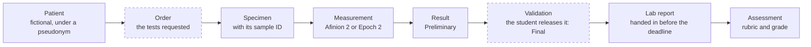
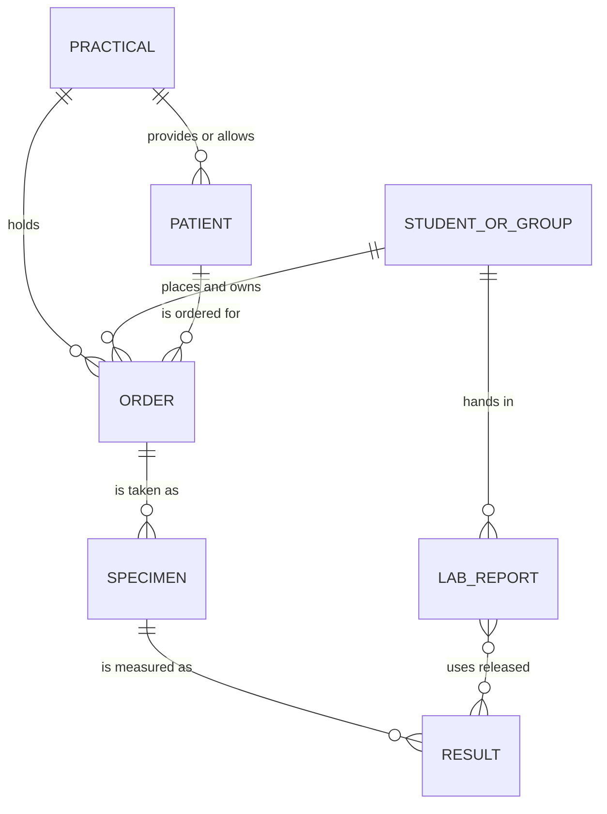
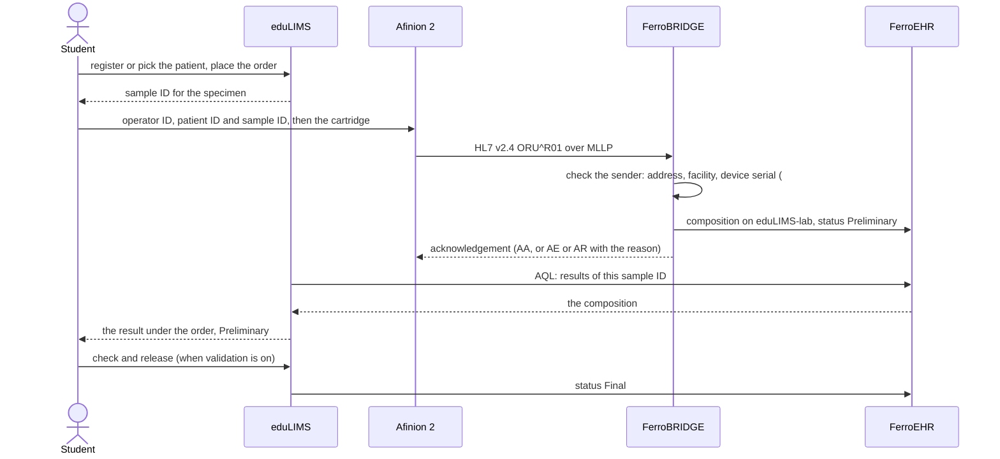
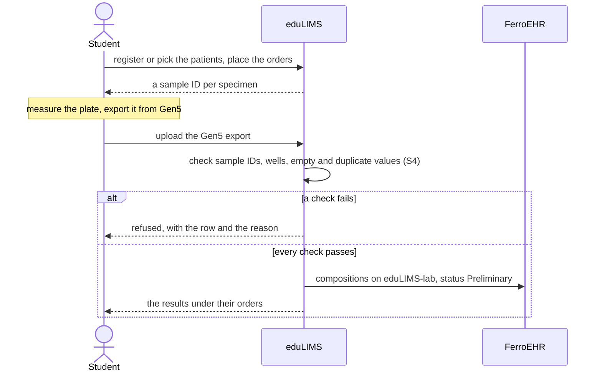
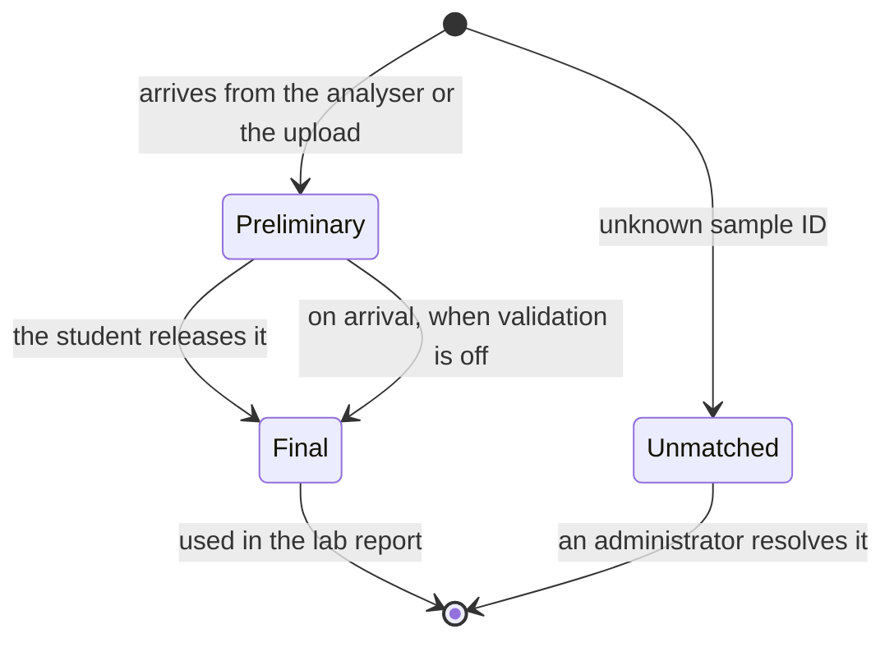

<!-- SPDX-FileCopyrightText: Ruben Talstra -->
<!-- SPDX-License-Identifier: Apache-2.0 -->

# The LIMS workflow

This page shows how a measurement travels through eduLIMS, from the patient a
student registers to the lab report the teacher grades. Students practise the
workflow of a real laboratory, so eduLIMS follows the chain a real LIMS
follows. The diagrams are the reference for building v0.3.0 (#132 to #185) and
for setting up the analysers.

Status: the chain and the fictional patients are the maintainer's decision of
2026-11-12, to be confirmed by the product owner and the privacy officer
(#131, X1). Points still open are marked **Open** with their issue.

## The chain

A real LIMS runs patient, order, specimen, result, validation and report.
eduLIMS runs the same chain. The teacher decides per practical which of the
optional steps (dashed) are on.

| Step | What happens | Who |
|---|---|---|
| Patient | A fictional patient: the case details the practical needs. The teacher provides the patients, or the students register them. | teacher or student |
| Order | The tests requested for that patient within the practical (for example HbA1c and CRP on the Afinion 2). Optional: without it, a specimen hangs directly under the patient. | student |
| Specimen | eduLIMS generates the sample ID for the specimen. The ID is unique and has a check character, so a typing mistake is caught. | eduLIMS |
| Measurement | The student measures the specimen on the analyser. | student |
| Result | The result reaches FerroEHR and shows in eduLIMS as Preliminary. | analyser, FerroBRIDGE, eduLIMS |
| Validation | The student checks the result and releases it as Final. Optional: without it, results are Final on arrival. | student |
| Lab report | The student hands in the report with the released results; it locks on submission and after the deadline (S6). | student |
| Assessment | The teacher grades it with the rubric (D4). | teacher |

## Who owns what, and where it lives

The work belongs to the student or the lab group who placed the order. Every
specimen and result hangs under that order, and every server function checks
that ownership in its database query, so no student can see, take or submit
another student's results (S7).

| Data | Lives in | Holds no |
|---|---|---|
| Practicals, patients (fictional details), orders, specimens and sample IDs, ownership, lab reports, grades | the eduLIMS database | measurement values |
| Each result as an openEHR composition on the `eduLIMS-lab` template, in the EHR of the patient's pseudonym, with the sample ID, the analyte, the value, the device and the time | FerroEHR | name, student number or email address (Q-PRIV-1) |

eduLIMS keeps no copy of a measurement: it reads results from FerroEHR with
AQL when a screen needs them, and stores the composition id (decided on #131,
X4).

## Configuration per practical

The teacher sets these when creating the practical (#132 to #135). The list
is a proposal for v0.3.0; the requirement it serves is D1.

| Setting | Choices | Default (proposal) |
|---|---|---|
| Patients | given by the teacher, or registered by the students | given by the teacher |
| Order step | on or off | on |
| Validation step | on or off | on |
| Work | individual or per lab group (#136) | individual |
| Analysers | Afinion 2, Epoch 2 or both | per practical |

## A measurement on the Afinion 2

The Afinion 2 sends each result itself over the lab network as HL7 v2.4 to
FerroBRIDGE, which writes it to FerroEHR. The student enters two identifiers
on the analyser: the analyser offers up to four patient ID fields and an
operator ID of up to 16 characters each (Afinion 2 User Manual, 1117346 Rev. A,
2023/02, "Patient ID" and "Operator ID", vendored in `docs/vendor/afinion/`).

- **Open, X3 on #131 and #209:** which HL7 fields carry the patient pseudonym
  and the sample ID. The manual says the entered ID goes out as "HIS Patient
  ID" or "Visit Number" (Table 2, "Patient ID As"); the exact segments are in
  Abbott's HL7 data sheet, which is not vendored yet.
- **Open, FerroHEALTH/FerroBRIDGE#1918:** the Afinion 2 has no TLS, and
  FerroBRIDGE 0.0.24 accepts MLLP only over TLS. The route waits on the
  address-bound plain lane for devices.
- **Open:** how eduLIMS learns about a new result within the minute of S5:
  FerroEHR's change feed, or a short query interval.
- A result whose sample ID eduLIMS does not know is never attached to a
  sample: it is logged and shown to administrators (#163).

## A measurement on the Epoch 2

The Epoch 2 has no network route here. The student exports the plate from
Gen5 and uploads the Excel file; eduLIMS checks it and writes the results to
FerroEHR over openEHR REST.

- **Open, #131:** the Gen5 version, the export layout and the assays per
  practical.

## The states of a result

## Setting up an Afinion 2

| Who | Where | What |
|---|---|---|
| The institution's IT | the lab network | a fixed address per Afinion 2; only those addresses reach the MLLP port of the eduLIMS server ([The MLLP port](deployment.md#the-mllp-port)) |
| The administrator | eduLIMS, Admin, Analysers and integrations | register each analyser: model, serial number, location |
| The operator of the server | `ferrobridge.toml` and the host firewall | one sender per analyser (facility, address, device), and the allow-list |
| The lab supervisor | the analyser, General settings, Connectivity settings | protocol HL7; server IP and port; receiving application and facility; Patient ID on; Operator ID on, optionally with verification against the analyser's operator list |

## Related

- [Architecture](architecture.md): the portals, the data split and the
  integrations.
- [Requirements](requirements.md): S3 to S7 and D1 to D4.
- [ADR 0013](adr/0013-internal-transport-security.md): the MLLP transport.
- #131: the decisions this page waits on.
