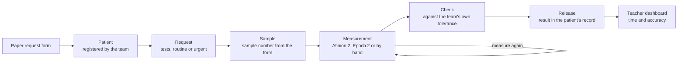
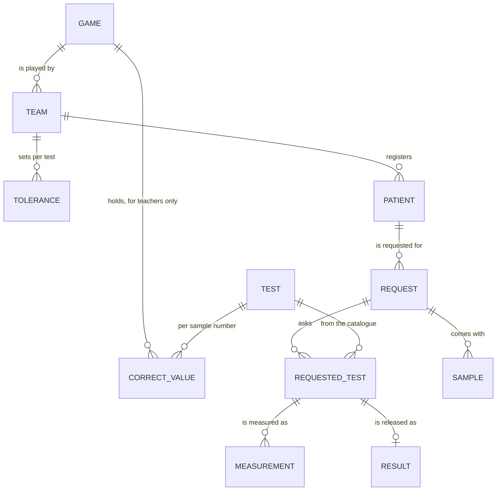
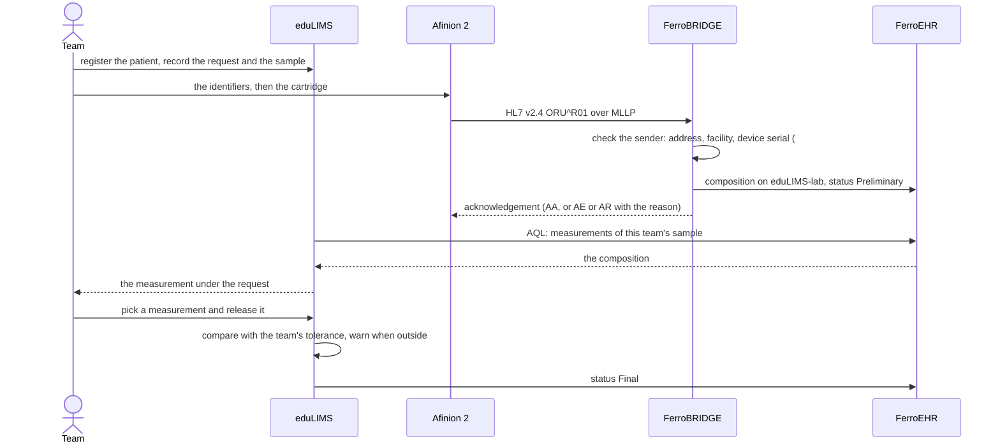
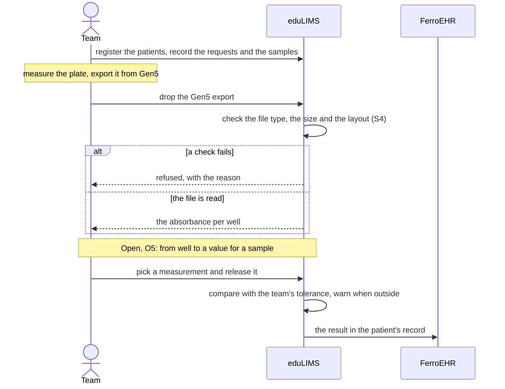
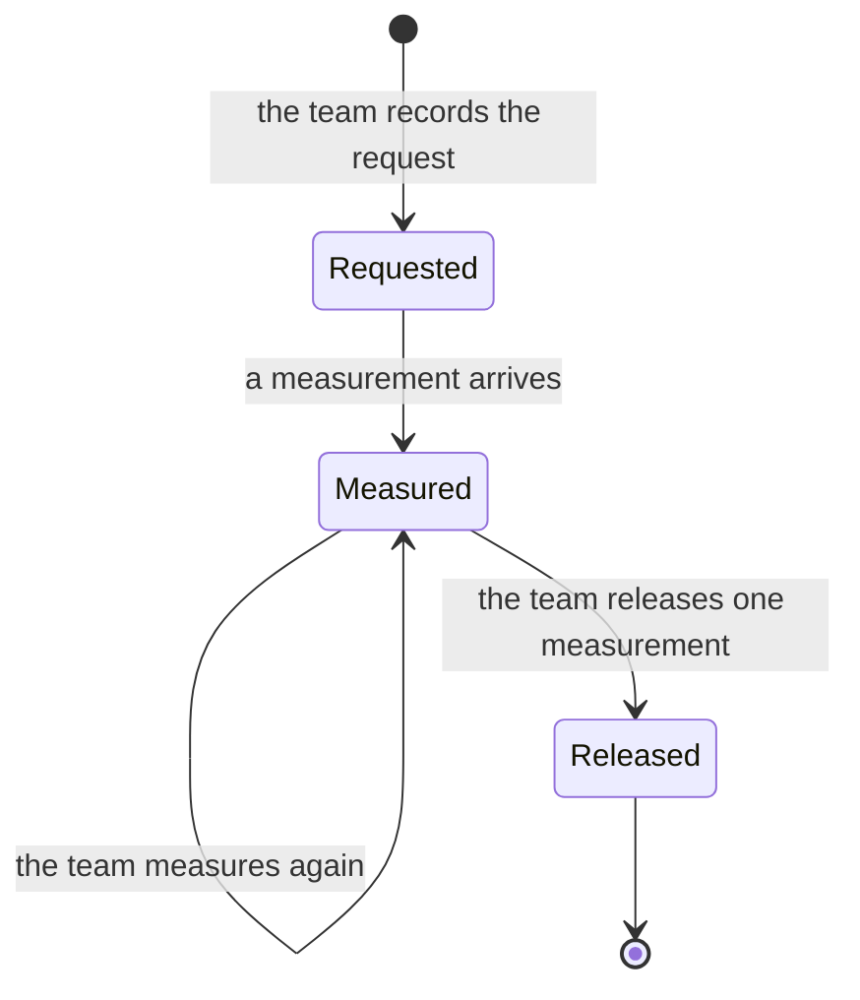

<!-- SPDX-FileCopyrightText: Ruben Talstra -->
<!-- SPDX-License-Identifier: Apache-2.0 -->

# The LIMS workflow

This page shows how the work of a team travels through eduLIMS during a
game, from the paper request form to the result in the patient's record and
on the teacher's dashboard. Teams practise the workflow of a real clinical
laboratory, so eduLIMS follows the chain a real LIMS follows
([ADR 0020](adr/0020-workplace-simulation.md)).

Status: the chain follows the owner's input of 2026-11-19. Points still open
are marked **Open** with the question in
[requirements.md](requirements.md#open-questions); nothing is built on an
open point.

## The chain

| Step | What happens | Who | Requirement |
|---|---|---|---|
| Tolerances | Before measuring, the team enters its own limits per test. | team | S13 |
| Patient | The team registers the patient from the form. eduLIMS fills in nothing. | team | S11 |
| Request | The team records the requested tests and whether the request is urgent. eduLIMS records the time of entry on the server. | team, eduLIMS | S12, Q-SIM-2 |
| Sample | The team links each sample by the sample number and the material on the form. | team | S12 |
| Measurement | The team measures. A value arrives from the Afinion 2, from the Epoch 2 upload, or is entered by hand where a test has no analyser route (Open, O4 and O8). A team can measure again; every measurement is kept. | team, analyser | S4, S5, S14 |
| Check | When the team picks a measurement to release, eduLIMS compares it with the team's own tolerance and warns when it is outside. The team decides. | eduLIMS, team | S15 |
| Release | The team releases the result to the patient's record. eduLIMS records the time of release on the server. | team, eduLIMS | S15, Q-SIM-2 |
| Dashboard | The teacher sees the request, its times and, after the release, the accuracy against the correct value. | teacher | D11 to D14 |

eduLIMS never shows a student a correct value, an accuracy status or the
work of another team (Q-SIM-1). The tolerance warning is the one check a
team gets, and it uses only what the team entered itself.

## Who owns what, and where it lives

The work belongs to the team. Every patient, request, sample, measurement
and result hangs under the team within a game, and every server function
checks that in its database query (S10). A teacher sees the teams of their
own games.

| Data | Lives in | Holds no |
|---|---|---|
| Games, teams, the test catalogue, correct values, tolerances, patients, requests, samples, the times of entry and release, the upload log and the audit log | the eduLIMS database | |
| Each result as an openEHR composition on the `eduLIMS-lab` template, in the EHR of the patient, with the sample number, the analyte, the value, the device and the time | FerroEHR | correct value, tolerance, accuracy status, or the name, student number or email address of a student or a teacher (Q-PRIV-1) |

- The patient's EHR in FerroEHR carries the fictional details the team
  registered (owner, 2026-11-19). No student or teacher is ever an EHR
  subject.
- **Open, O7:** where a measurement lives before its release. The template
  has a result status (Preliminary, Final), so one design keeps every
  measurement in FerroEHR as Preliminary and makes the released one Final.
  The Afinion 2 route already writes to FerroEHR on arrival, which fits that
  design. It is a proposal of the maintainer until the owner answers O7.

## A measurement on the Afinion 2

The Afinion 2 sends each result itself over the lab network as HL7 v2.4 to
FerroBRIDGE, which writes it to FerroEHR. The analyser offers up to four
patient ID fields and an operator ID of up to 16 characters each (Afinion 2
User Manual, 1117346 Rev. A, 2023/02, "Patient ID" and "Operator ID",
vendored in `docs/vendor/afinion/`).

- **Open, O13:** every team works the same sample numbers, so the sample
  number alone does not say whose result arrived. Which identifier the team
  enters on the analyser to name itself (the operator ID, a second patient ID
  field) or whether each team has its own analyser is the owner's decision.
- **Open, #209:** which HL7 fields carry the entered identifiers. The manual
  says the entered ID goes out as "HIS Patient ID" or "Visit Number" (Table 2,
  "Patient ID As"); the exact segments are in Abbott's HL7 data sheet, which
  is not vendored yet.
- **Open, FerroHEALTH/FerroBRIDGE#1918:** the Afinion 2 has no TLS, and
  FerroBRIDGE 0.0.24 accepts MLLP only over TLS. The route waits on the
  address-bound plain lane for devices.
- **Open:** how eduLIMS learns about a new measurement within the minute of
  S5: FerroEHR's change feed, or a short query interval.
- A result that eduLIMS cannot link to a team's sample is never attached to
  one: it is logged and shown to administrators (#163).

## A measurement on the Epoch 2

The Epoch 2 has no network route here. The team exports the plate from Gen5
and drops the Excel file on the upload area; eduLIMS reads it.

The export is one sheet: a header block (software version, date, time,
reader type and serial number, plate type, read type, wavelength,
temperature) and a 96-well grid, rows A to H and columns 1 to 12, of
absorbance values at one wavelength. It holds no sample number, no plate
layout and no concentration.

- **Open, O5:** how a well becomes a value for a sample. The maintainer's
  proposal: the team records the plate layout in eduLIMS (which well holds
  which sample, standard, blank and control), as an analyst prepares a
  worklist in a real LIMS. Per test the teacher chooses one of two ways:
  eduLIMS calculates the concentration from the team's own standards and
  shows the calibration line for the team to judge, or the team calculates
  and enters the result. Neither way uses a correct value.

## The states of a requested test

The clock of G-01 runs from Requested to Released (Open, O1: whether it
starts earlier, when a teacher hands out the sample). Whether a released
result can be corrected is open (O7).

## The teacher's side

Before a game a teacher manages the test catalogue (D9), prepares the game
and enters the correct value per test and sample (D10), and sets the time
target for urgent requests (D12) and the limits for green, yellow and red
(D13). During the game the dashboard shows every team's requests with their
times and the accuracy of each released result (D11), and the ranking (D14).
The design is in [game-dashboard.md](game-dashboard.md).

## Setting up an Afinion 2

| Who | Where | What |
|---|---|---|
| The institution's IT | the lab network | a fixed address per Afinion 2; only those addresses reach the MLLP port of the eduLIMS server ([The MLLP port](deployment.md#the-mllp-port)) |
| The administrator | eduLIMS, Admin, Analysers and integrations | register each analyser: model, serial number, location |
| The operator of the server | `ferrobridge.toml` and the host firewall | one sender per analyser (facility, address, device), and the allow-list |
| The lab supervisor | the analyser, General settings, Connectivity settings | protocol HL7; server IP and port; receiving application and facility; Patient ID on; Operator ID on, optionally with verification against the analyser's operator list |

## Related

- [Architecture](architecture.md): the portals, the data split and the
  integrations.
- [Requirements](requirements.md): S4, S5, S10 to S15, D9 to D14 and the
  open questions.
- [ADR 0020](adr/0020-workplace-simulation.md): the decision for the
  simulation.
- [ADR 0013](adr/0013-internal-transport-security.md): the MLLP transport.
